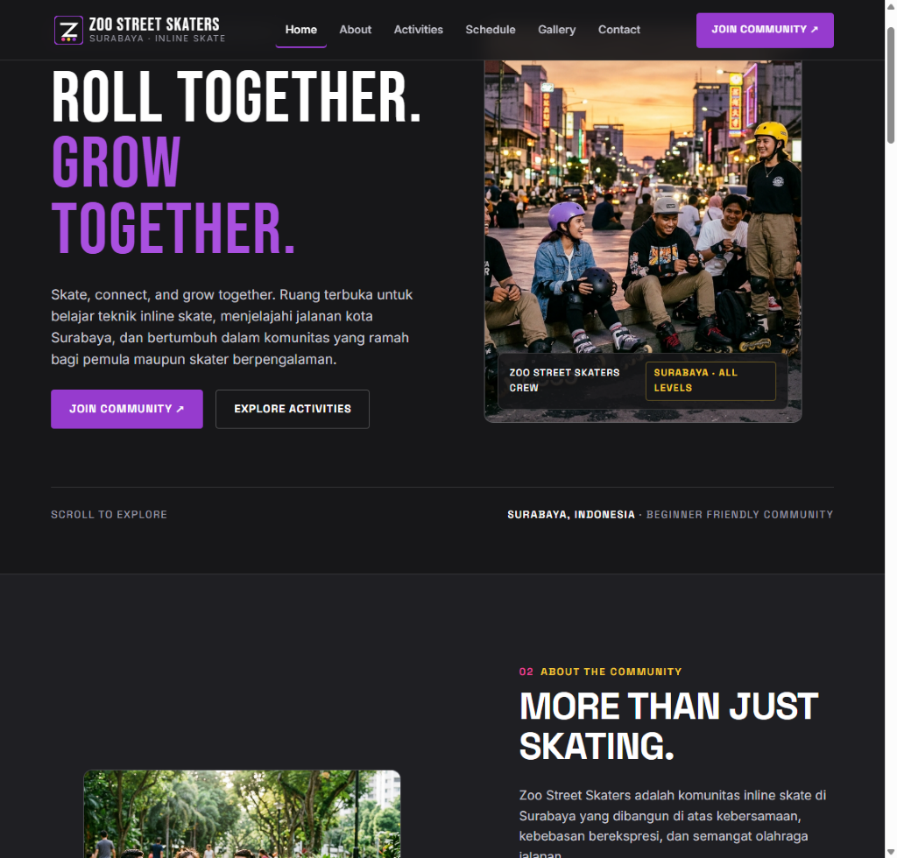
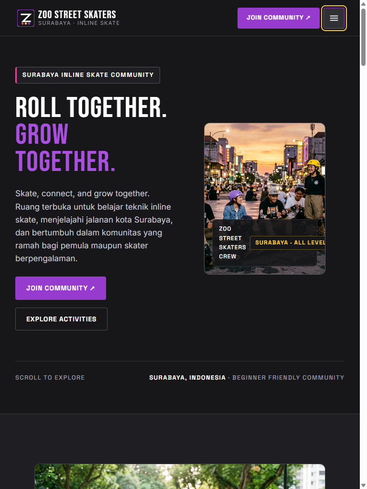
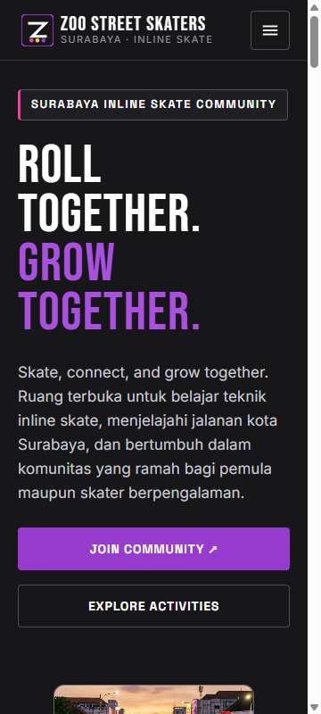

# Zoo Street Skaters — Urban Skate Community Website (Surabaya)

Website resmi komunitas inline skate **Zoo Street Skaters Surabaya**, dibangun dengan **HTML5, CSS3, dan Vanilla JavaScript** menggunakan pendekatan **Urban Editorial + Sport Community** (dark-mode-first).

- **Live Demo (GitHub Pages)**: `https://maizu28.github.io/uts-paw-p1-zoostreetskaters/`
- **Repositori**: `https://github.com/Maizu28/uts-paw-p1-zoostreetskaters`

---

## 1. Identitas Anggota (G4)

| NPM | Nama Lengkap | Akun GitHub | Halaman / Bagian yang Dikerjakan |
| --- | --- | --- | --- |
| `[Isi NPM]` | `[Isi Nama Lengkap]` | [`@Maizu28`](https://github.com/Maizu28) | `index.html` (Single-Page Sections 01–08), CSS Design System (`css/`), Vanilla JS (`js/`) |

---

## 2. Sub-Tema, Nama Usaha, & Target Pengguna

- **Sub-tema**: Komunitas Olahraga & Budaya Jalanan (Urban Skate Community)
- **Nama Usaha / Komunitas**: **Zoo Street Skaters** — Surabaya, Indonesia (*Roll Together. Grow Together.*)
- **Target Pengguna**:
  - **Pemula**: Calon anggota yang baru memiliki atau ingin belajar inline skate dari dasar dalam suasana suportif tanpa rasa terintimidasi.
  - **Skater Berpengalaman**: Anggota yang mencari jadwal latihan rutin, teman *urban rolling*, sesi *freestyle slalom*, dan *skatepark meetup* di Surabaya.

---

## 3. Sitemap & Sketsa Denah (Mobile & Desktop)

### Sitemap (Single-Page Anchor Architecture)

```text
index.html (Zoo Street Skaters)
├── Header / Navbar (Logo, Home, About, Activities, Schedule, Gallery, Contact, CTA Join)
├── #hero       — 01 Hero (Identitas komunitas, tagline, CTA Join & Explore, foto kru)
├── #about      — 02 About Community (Profil singkat, foto grup, pilar Learn. Skate. Connect.)
├── #activities — 03 Activities (Freestyle Slalom, Urban Skating, Skate Park, Community Gathering + Detail Modal)
├── #schedule   — 04 Weekly Schedule (Notice jadwal provisional & cuaca, Selasa/Jumat/Minggu + Google Maps)
├── #events     — 05 Events (Static MVP highlight event + Detail Modal + Instagram link)
├── #gallery    — 06 Gallery (Filter: All, Events, Freestyle, Urban + 9 foto + Lightbox)
├── #join       — 07 Join Community (Checklist ramah pemula + CTA WhatsApp & Instagram)
└── footer      — 08 Footer (Brand summary, navigasi anchor, kontak Surabaya)
```

### Sketsa Denah Desktop (`≥ 1024px`, 12 Kolom)

```text
+-------------------------------------------------------------------+
| [LOGO]       Home  About  Activities  Schedule  Gallery  [JOIN ↗] |
+-------------------------------------------------------------------+
| SURABAYA INLINE SKATE COMMUNITY                                   |
| ROLL TOGETHER.                 +-------------------------------+  |
| GROW TOGETHER.                 |                               |  |
| Subheadline singkat...         |        HERO CREW PHOTO        |  |
| [JOIN COMMUNITY ↗] [EXPLORE]   +-------------------------------+  |
+-------------------------------------------------------------------+
| 02 ABOUT: [ GROUP PHOTO (6 col) ]   [ STORY + PILLARS (5 col) ]   |
| 03 ACTIVITIES: Asymmetrical 12-col Grid (7+5, 5+7)                |
| 04 SCHEDULE: Notices (2 col) + Scannable Rows (Day | Info | MAP↗) |
| 05 EVENTS: 2-Column Static Event Cards                            |
| 06 GALLERY: Filter Bar + 3-Column Photo Grid (Click -> Lightbox)  |
| 07 JOIN: 12-Col Panel (Copy & Checklist 7 col | Actions 5 col)    |
| 08 FOOTER: Brand (2fr) | Navigation (1fr) | Connect (1fr)         |
+-------------------------------------------------------------------+
```

### Sketsa Denah Mobile (`≤ 767px`, 4 Kolom)

```text
+---------------------------+
| [LOGO]               [☰]  |
+---------------------------+
| SURABAYA SKATE COMMUNITY  |
| ROLL TOGETHER.            |
| GROW TOGETHER.            |
| Subheadline...            |
| [   JOIN COMMUNITY ↗    ] |
| [  EXPLORE ACTIVITIES   ] |
| +-----------------------+ |
| |      HERO PHOTO       | |
| +-----------------------+ |
+---------------------------+
| 02 ABOUT (Stack 1 col)    |
| 03 ACTIVITIES (2-col grid)|
| 04 SCHEDULE (Stack 1 col) |
| 05 EVENTS (Stack 1 col)   |
| 06 GALLERY (2-col grid)   |
| 07 JOIN (Stack 1 col)     |
| 08 FOOTER (Stack 1 col)   |
+---------------------------+
```

---

## 4. Tabel Design Token (`css/variables.css`)

| Kategori | Custom Property | Nilai | Fungsi |
| --- | --- | --- | --- |
| **Color** | `--color-ink-black` | `#171719` | Background utama halaman (dark mode) |
| **Color** | `--color-ink-elevated` | `#1F1F23` | Permukaan section selang-seling |
| **Color** | `--color-concrete` | `#303035` | Permukaan kartu & panel konten |
| **Color** | `--color-street-purple` | `#963BCE` | Primary CTA button & indikator aktif |
| **Color** | `--color-pure-white` | `#FFFFFF` | Teks utama kontras tinggi |
| **Color** | `--color-neon-pink` | `#F0449B` | Aksen indeks/highlight (proporsi terbatas) |
| **Color** | `--color-skate-yellow` | `#F6CA38` | Aksen label & indikator `:focus-visible` |
| **Typography** | `--font-display` | `'Bebas Neue', Impact, sans-serif` | Hero headline (`clamp(3.75rem, 8vw, 6.75rem)`) |
| **Typography** | `--font-heading` | `'Space Grotesk', system-ui, sans-serif` | Section & card heading |
| **Typography** | `--font-body` | `'Inter', system-ui, sans-serif` | Body text (`16px`), navigasi (`14px`), caption |
| **Spacing** | `--space-xs` .. `--space-4xl` | `4px` .. `96px` | Sistem spasi kelipatan `4px` |
| **Layout** | `--container-max` | `1200px` | Lebar maksimum area konten utama |
| **Radius** | `--radius-sm` / `--radius-md` / `--radius-lg` | `4px` / `8px` / `12px` | Sudut tombol, badge, dan kartu |
| **Motion** | `--transition-fast` / `--transition-base` | `200ms` / `260ms` | Transisi halus tanpa animasi looping |

---

## 5. Tabel Breakpoint (`css/responsive.css`)

| Breakpoint | Media Query | Container Padding | Perubahan Layout Utama |
| --- | --- | --- | --- |
| **Desktop** | `≥ 1024px` (default) | `64px` | Navbar horizontal, grid 12 kolom, hero 2 kolom, galeri 3 kolom |
| **Tablet** | `@media (max-width: 1023px)` | `32px` | Navigasi desktop diganti drawer + tombol Join, about/join stack, galeri 2 kolom |
| **Mobile** | `@media (max-width: 767px)` | `20px` | Grid 4 kolom, tombol CTA full-width, activity 2 kolom, schedule 1 kolom |
| **Small Mobile** | `@media (max-width: 390px)` | `20px` | Activity card menjadi 1 kolom agar teks tetap lega dibaca |

---

## 6. Penjelasan Framework vs CSS Sendiri (E4)

Proyek ini **sengaja tidak menggunakan framework CSS/JS** (seperti Bootstrap, Tailwind CSS, jQuery, React, atau Vue) dan dibangun 100% menggunakan **HTML5, CSS3 native, dan Vanilla JavaScript**:
1. **Kontrol Penuh Design System**: Custom properties pada `css/variables.css` memetakan palet warna komunitas (`#171719`, `#963BCE`, `#F0449B`, `#F6CA38`), skala tipografi `clamp()`, dan spacing kelipatan `4px` tanpa bloat class utilitas pihak ketiga.
2. **Layout Asimetris Presisi**: CSS Grid 12 kolom (`7+5`, `5+7` pada kartu aktivitas dan `7+5` pada panel Join) dan Flexbox native memberikan struktur editorial yang ringan tanpa override style framework.
3. **Performa & Zero Build Step**: Tanpa dependensi `node_modules` atau bundler, total aset kode sangat kecil dan langsung siap di-deploy ke **GitHub Pages** maupun dibuka di browser/Live Server.

---

## 7. Tangkapan Layar (`360px`, `768px`, `1280px`, & Mode Gelap)

Website menggunakan desain **dark-mode-first** (`#171719` Ink Black & `#303035` Concrete) sebagai tampilan utama di seluruh breakpoint:

| Desktop (`1280×800`, Dark Mode) | Tablet (`768×1024`, Dark Mode) | Mobile (`360×800`, Dark Mode) |
| --- | --- | --- |
|  |  |  |

---

## 8. Kualitas: Lighthouse, W3C Validator, & Uji Keyboard

- **Skor Lighthouse**: `[Isi setelah menjalankan audit Lighthouse di Chrome DevTools pada URL GitHub Pages]`
- **Hasil W3C Validator**: `[Isi setelah validasi index.html & CSS via validator.w3.org]`
- **Catatan Uji Keyboard (Terverifikasi di Browser)**:
  - Menekan `Tab` langsung memfokuskan `.skip-link` (*"Langsung ke konten utama"*) dan menampilkan indikator `:focus-visible` (`2px solid #F6CA38`).
  - Seluruh tombol filter, kartu aktivitas, thumbnail galeri, dan tautan memiliki fokus keyboard dan ukuran target sentuh minimum `44×44px`.
  - Menekan `Enter` pada kartu aktivitas dan foto galeri membuka dialog modal/lightbox (`role="dialog"`, `aria-modal="true"`).
  - Menekan `ArrowLeft` / `ArrowRight` pada Lightbox menavigasi foto sesuai kategori aktif, dan `Escape` menutup drawer mobile, modal detail, maupun lightbox sekaligus mengembalikan fokus ke elemen pemicu.

---

## 9. Sumber Aset & Pernyataan Penggunaan AI

### Sumber Gambar, Ikon, & Font
- **Tipografi**: Google Fonts ([Bebas Neue](https://fonts.google.com/specimen/Bebas+Neue), [Space Grotesk](https://fonts.google.com/specimen/Space+Grotesk), [Inter](https://fonts.google.com/specimen/Inter)) dengan fallback font sistem lokal.
- **Logo & Ikon**: Custom inline SVG (`assets/images/logo.svg` & ikon menu hamburger di `index.html`).
- **Foto Placeholder Sementara**: Gambar kegiatan inline skate sementara di `assets/images/` dibuat menggunakan AI image generator sebagai placeholder visual terstruktur hingga dokumentasi foto asli komunitas Zoo Street Skaters diunggah.

### Pernyataan Penggunaan AI
- **Alat yang digunakan**: **Google Antigravity (Gemini)**
- **Bagian yang dibantu AI**:
  1. Penyusunan struktur HTML5 semantik, stylesheet modular (`variables.css`, `style.css`, `components.css`, `responsive.css`), serta skrip Vanilla JS (`navigation.js`, `gallery.js`, `main.js`) sesuai spesifikasi desain.
  2. Pembuatan aset foto inline skate placeholder sementara di `assets/images/` dan logo vektor awal (`logo.svg`).
  3. Pengujian responsivitas lintas viewport (`360px`, `768px`, `1280px`), navigasi keyboard, dan dokumentasi `README.md`.

---

## 10. Checklist Penggantian Konten Resmi Sebelum Publikasi Final

1. Ganti `assets/images/logo.svg` dan foto di `assets/images/` dengan logo serta dokumentasi foto asli Zoo Street Skaters.
2. Ganti komentar `PLACEHOLDER LINK` di `index.html` (tautan `wa.me/...` dan `instagram.com/...`) dengan kontak resmi komunitas.
3. Perbarui jam latihan terkonfirmasi pada bagian `#schedule` di `index.html`.
4. Isi NPM, Nama Lengkap, skor Lighthouse, dan hasil W3C Validator pada `README.md`.
